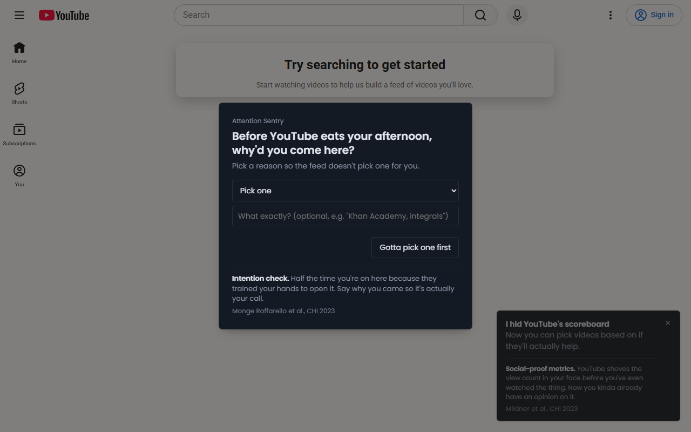

# Thomas Dupree

CS and math student at Saint Louis University, graduating 2028. I spent spring 2026 studying in Madrid. Summers I'm a head lifeguard, and the rest of the year I'm in the SLU pep band.

[LinkedIn](https://linkedin.com/in/thomas-dupree) · [Portfolio](https://tomup5.github.io)

## Attention Sentry

A Chrome extension for studying on YouTube, Reddit, Wikipedia, Discord, and the New York Times. You can't just block YouTube when your lecture is on there, so it goes after the features built to keep you there instead: infinite feeds, autoplay, view counts. When it steps in, it tells you which pattern it caught.

| Asks why you came, before the feed loads | Catches a link-hopping trail on Wikipedia |
| :---: | :---: |
|  |  |

YouTube keeps renaming its CSS classes, so view counts are matched by their text ("1.2M views") instead of by selector.

[Code](https://github.com/tomup5/AttentionSentry-ChromeExtension) · [Chrome Web Store](https://chromewebstore.google.com/detail/attention-sentry-study-wi/amfaapdddenljaahkfjhbffofjacekfn)

## Other projects

- **[Truss Cut-list Calculator](https://github.com/tomup5/truss-cutlist-calculator)**: works out the cut list for a roof truss from its geometry. ASP.NET Core API with a React and TypeScript frontend.
- **[Taxify](https://github.com/tomup5/Taxify)**: a ride-hailing and scooter-rental simulation in Java, built with a teammate. Seeded test runs check after every step that no rider is ever booked twice.
- **Internship Pipeline** (private): a local tool that finds internships and helps tailor applications, with me approving each step.

  <picture>
    <source media="(prefers-color-scheme: dark)" srcset="https://raw.githubusercontent.com/tomup5/tomup5/output/snake-dark.svg" />
    <source media="(prefers-color-scheme: light)" srcset="https://raw.githubusercontent.com/tomup5/tomup5/output/snake.svg" />
    
  </picture>

