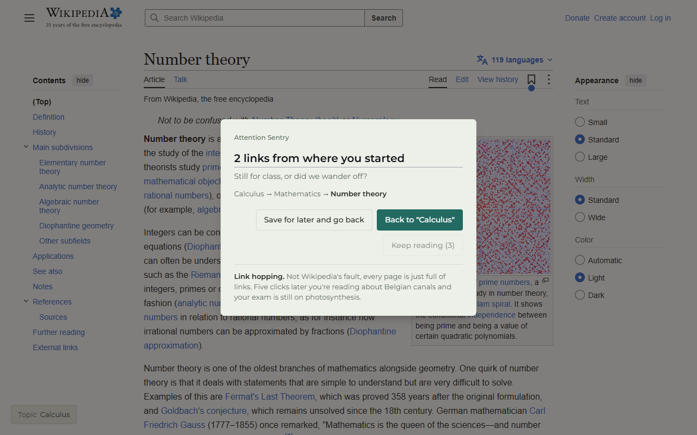

  
  
  

CS and math student at Saint Louis University, graduating 2028. I spent spring 2026 studying in Madrid. Summers I'm a head lifeguard, and the rest of the year I play trumpet in the SLU pep band.

## Projects

  
  

  
  

### Attention Sentry in action

You can't just block YouTube when your lecture is on there, so Attention Sentry goes after the features built to keep you there instead: infinite feeds, autoplay, view counts. When it steps in, it tells you which pattern it caught.

| Asks why you came, before the feed loads | Catches a link-hopping trail on Wikipedia |
| :---: | :---: |
|  |  |

YouTube keeps renaming its CSS classes, so view counts are matched by their text ("1.2M views") instead of by selector.

## Tech stack

  <picture>
    <source media="(prefers-color-scheme: dark)" srcset="https://raw.githubusercontent.com/tomup5/tomup5/output/snake-dark.svg" />
    <source media="(prefers-color-scheme: light)" srcset="https://raw.githubusercontent.com/tomup5/tomup5/output/snake.svg" />
    
  </picture>

