<!-- Header -->

  

  
  
  

<h2 align="center">🚀 Featured Projects</h2>

  
  

  
  

<h2 align="center">👨‍💻 About Me</h2>

- 🎓 **B.S. Computer Science + B.A. Mathematics** at Saint Louis University (May 2028)
- 🌍 Studied software engineering and physics at **SLU Madrid** (Spring 2026)
- 🧪 I like proving my code works: jsdom suites, seeded simulations, and CI on every push
- 🛟 **Head lifeguard**, leading a team of 14+ guards
- 🎺 SLU Pep Band and intramural sports

<h2 align="center">🛠️ Tech Stack</h2>

   
  

<h2 align="center">📊 GitHub Stats</h2>

  
  

  

  <picture>
    <source media="(prefers-color-scheme: dark)" srcset="https://raw.githubusercontent.com/tomup5/tomup5/output/snake-dark.svg" />
    <source media="(prefers-color-scheme: light)" srcset="https://raw.githubusercontent.com/tomup5/tomup5/output/snake.svg" />
    
  </picture>

<!-- Footer -->

